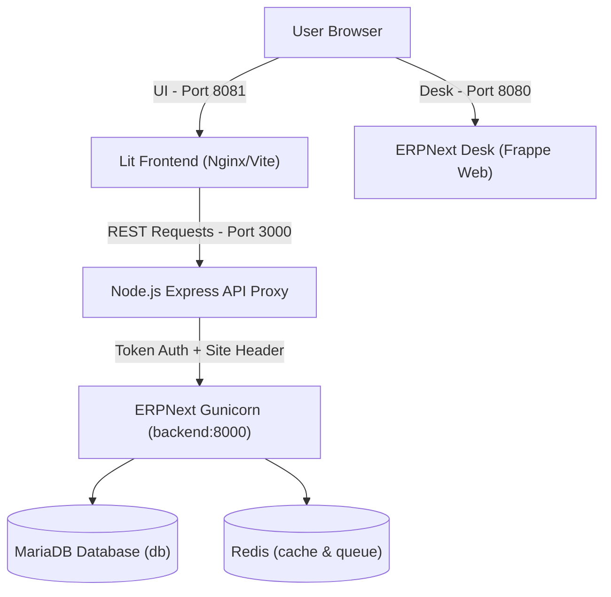

# 📦 Inventory Management System

A full-stack Inventory Management application powered by **Lit Web Components** for the frontend, a **Node.js Express** API proxy, and **ERPNext (Frappe)** as the backend, orchestrated seamlessly with **Docker Compose**.

---

## 🏗️ Architecture Overview



| Layer | Component | Path | Port | Description |
| :--- | :--- | :--- | :--- | :--- |
| **Frontend** | Lit Web Components | [`frontend/`](file:///d:/inventory-management/frontend) | `8081` | Single-page UI with grid/list view, search, tag filters, item creation, and image uploads |
| **API Proxy** | Express.js Server | [`api-proxy/`](file:///d:/inventory-management/api-proxy) | `3000` | Securely injects ERPNext API tokens, formats tag metadata, handles file uploads (`/uploads`), and handles CORS |
| **Backend** | ERPNext v16 / Frappe | [`frappe_docker/`](file:///d:/inventory-management/frappe_docker) | `8080` (Desk)<br>`8000` (Internal) | ERPNext core backend, REST APIs (`/api/resource/Item`), MariaDB database, Redis queues, scheduler |

---

## 📋 Prerequisites

Before setting up in a new environment, make sure you have installed:

1. **[Docker Desktop](https://docs.docker.com/get-docker/)** (v24.0+ recommended with Compose v2.20+)
   - Ensure Docker Desktop is running and allocated at least 4 GB of RAM.
2. **[Git](https://git-scm.com/)**
3. *(Optional for standalone local development)*: **[Node.js](https://nodejs.org/)** (v18+)

---

## 🚀 Fresh Environment Setup (Step-by-Step)

Follow these steps to run the complete stack from scratch on any new machine.

### Step 1: Clone the Repository

Clone the project and ensure all nested repositories/submodules are fetched:

```bash
git clone https://github.com/Prathamesh251/Inventory-Management.git
cd Inventory-Management
```

> [!IMPORTANT]
> **If `frappe_docker/` is empty after cloning:**
> `frappe_docker` contains its own `.git` history and Docker configurations. If it is empty after cloning, run:
> ```bash
> # Option A: If registered as a Git submodule:
> git submodule update --init --recursive
> 
> # Option B: If frappe_docker folder is empty:
> git clone https://github.com/frappe/frappe_docker
> ```
> *(Note: Ensure `frappe_docker/pwd.yml` is present, as `docker-compose.yml` includes it).*

#### 💡 How to Permanently Include `frappe_docker` in this Repository (For Maintainers)
To prevent `frappe_docker` from ever being empty for new cloners, remove its internal `.git` folder and commit it as regular tracked files in the main repository:

```bash
# 1. Untrack the nested gitlink in the parent repo
git rm --cached frappe_docker

# 2. Remove the inner .git folder inside frappe_docker
# On Windows PowerShell:
Remove-Item -Recurse -Force frappe_docker\.git
# On Linux / macOS:
rm -rf frappe_docker/.git

# 3. Add and commit frappe_docker directly to your main repo
git add frappe_docker
git commit -m "Include frappe_docker files directly in repository"
git push origin main
```
Once done, anyone running `git clone` will immediately get all `frappe_docker` files with zero extra steps!

---

### Step 2: Configure Environment Variables

Create the `.env` file in the project root (`Inventory-Management/`):

```bash
# On Linux / macOS:
cp .env.example .env

# On Windows PowerShell:
Copy-Item .env.example .env -ErrorAction SilentlyContinue
```

Ensure your root [`.env`](file:///d:/inventory-management/.env) contains:

```env
PORT=3000
ERPNEXT_URL=http://backend:8000
ERPNEXT_API_KEY=your_api_key_here
ERPNEXT_API_SECRET=your_api_secret_here
```

> 💡 **Notice:** On the very first run, leave placeholder values for `ERPNEXT_API_KEY` and `ERPNEXT_API_SECRET`. You will generate them in **Step 4** once ERPNext finishes initializing.

---

### Step 3: Launch Containers with Docker Compose

Start the entire stack (ERPNext services, MariaDB, Redis, API Proxy, and Lit Frontend):

```bash
docker compose up -d
```

#### ⏳ Critical First-Time Initialization Wait (2–5 minutes)
On a brand new machine, the `create-site` container automatically provisions the site database and installs ERPNext into MariaDB. 

Monitor progress by streaming the setup logs:

```bash
docker compose logs -f create-site
```

When you see the container finish successfully (exit code `0`), ERPNext is fully initialized! Press `Ctrl + C` to stop viewing the logs.

---

### Step 4: Generate ERPNext API Credentials

To allow the frontend and API proxy to read and create inventory items:

1. Open your browser and go to **ERPNext Desk**: [http://localhost:8080](http://localhost:8080)
2. Log in using default administrator credentials:
   - **Username:** `Administrator`
   - **Password:** `admin`
3. If prompted by the one-time **Setup Wizard**, quickly complete it (choose your Country, Language, Currency, and create a company profile).
4. In the top search bar (or Awesome Bar), search for **User List** and click on **Administrator**.
5. Scroll down to the **API Access** section.
6. Click **Generate Keys**.
7. An alert will display:
   - **API Key** (e.g. `19c03b5eb6083e3`)
   - **API Secret** (e.g. `0abb9c06cd2cea7`)
   > ⚠️ **Important:** Copy the **API Secret** immediately. ERPNext will never show it again.
8. Open your root [`.env`](file:///d:/inventory-management/.env) file and paste the credentials:
   ```env
   PORT=3000
   ERPNEXT_URL=http://backend:8000
   ERPNEXT_API_KEY=your_copied_api_key
   ERPNEXT_API_SECRET=your_copied_api_secret
   ```
9. Restart the **API Proxy** container to apply the new keys:
   ```bash
   docker compose restart api-proxy
   ```

---

### Step 5: Access & Verify the Application

Once configured, verify all components are communicating:

| Service | Address | Description | Verification Check |
| :--- | :--- | :--- | :--- |
| **Lit Frontend UI** | [http://localhost:8081](http://localhost:8081) | Main user interface | Dashboard loads, shows inventory grid/list |
| **API Proxy** | [http://localhost:3000/api/items](http://localhost:3000/api/items) | Backend bridge | Returns JSON array `[]` or list of items |
| **ERPNext Desk** | [http://localhost:8080](http://localhost:8080) | ERP Administrator portal | Stock > Item DocType displays newly added items |

#### End-to-End Test:
1. Open [http://localhost:8081](http://localhost:8081).
2. Click **+ Add Item**.
3. Fill in:
   - **Item Name:** `MacBook Pro M3`
   - **Description:** `16GB RAM, 512GB SSD`
   - **Category / Tags:** `Electronics, Computers`
   - **Image:** Upload a JPG/PNG image.
4. Click **Create Item**.
5. The item should appear instantly in the frontend inventory view and in ERPNext under **Stock > Items**.

---

## 💻 Standalone Local Development (Optional)

If you are actively developing the frontend or API proxy without rebuilding Docker images on each code edit:

1. **Keep only ERPNext running in Docker:**
   ```bash
   docker compose -f ./frappe_docker/pwd.yml up -d
   ```

2. **Run the API Proxy locally:**
   ```bash
   cd api-proxy
   npm install
   # Set in api-proxy/.env:
   # ERPNEXT_URL=http://localhost:8080
   # ERPNEXT_API_KEY=...
   # ERPNEXT_API_SECRET=...
   npm start
   ```

3. **Run the Frontend locally:**
   ```bash
   cd frontend
   npm install
   npm run dev
   ```
   The Vite dev server will start at `http://localhost:5173`.

---

## 🔌 API Endpoints Reference

The Express proxy (`http://localhost:3000`) provides the following endpoints:

| Method | Endpoint | Description | Payload / Notes |
| :--- | :--- | :--- | :--- |
| `GET` | `/api/items` | Fetch all items | Supports `?filters=` and `?order_by=` query params |
| `POST` | `/api/items` | Create new item | `{ item_name, description, tags, image }` |
| `PUT` | `/api/items/:name` | Update item | `{ item_name, description, tags, image }` |
| `DELETE` | `/api/items/:name` | Delete item | Deletes item matching ERPNext `name` / item code |
| `POST` | `/api/upload` | Upload image file | `multipart/form-data` with key `image`. Returns image URL |

---

## 🗄️ Inspecting Data in MariaDB

To directly verify items stored in MariaDB:

1. Open a shell into the database container:
   ```bash
   docker exec -it inventory-management-db-1 mariadb -u root -padmin
   ```

2. Show databases and use your ERPNext site database:
   ```sql
   SHOW DATABASES;
   -- Choose the database beginning with `_` (e.g. `_1234567890abcdef`)
   USE `<your_database_name>`;
   ```

3. Query stored inventory records:
   ```sql
   SELECT name, item_name, item_group, description FROM tabItem ORDER BY creation DESC LIMIT 5;
   ```

4. Exit MariaDB:
   ```sql
   EXIT;
   ```

---

## 🛠️ Troubleshooting & FAQs

### 1. `create-site` container fails or stays in restarting state
- Ensure Docker Desktop has at least **4 GB of RAM** and sufficient free disk space.
- Inspect logs:
  ```bash
  docker compose logs -f create-site
  ```

### 2. Frontend shows `Failed to fetch items` / API Proxy returns `401 Unauthorized`
- You need to generate API credentials in ERPNext Desk (`http://localhost:8080`) as described in [Step 4](#step-4-generate-erpnext-api-credentials).
- Verify the keys in `.env`, and restart the proxy:
  ```bash
  docker compose restart api-proxy
  ```

### 3. Port Conflicts (`8080`, `8081`, or `3000` already in use)
- If port `8080` or `3000` is already taken by another service on your host machine, change the external port mapping in [docker-compose.yml](file:///d:/inventory-management/docker-compose.yml) (e.g., `"8082:80"`, `"3001:3000"`).

### 4. How to completely reset and start fresh?
To wipe all containers, databases, and volumes for a clean slate:
```bash
docker compose down -v
docker compose up -d
```
*(Then repeat [Step 4](#step-4-generate-erpnext-api-credentials) to generate new API keys).*